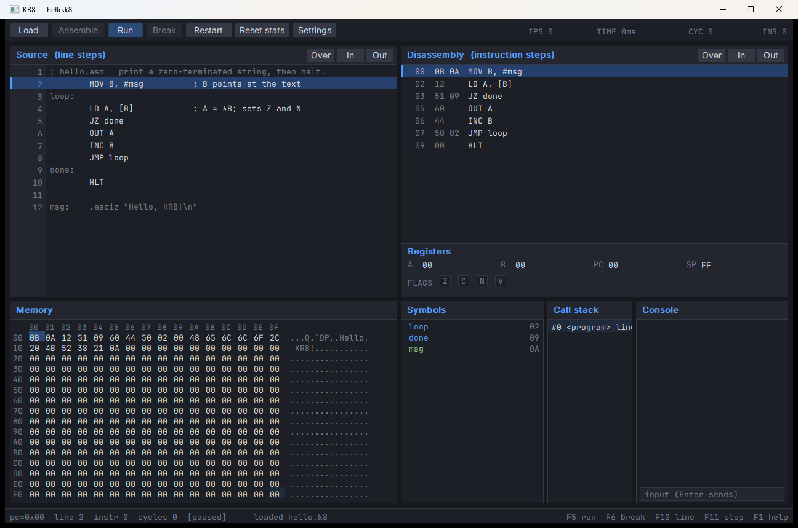

# KR8

KR8 is an 8-bit teaching computer: a 256-byte machine, a small assembler and
disassembler, a headless VM, and a windowed debugger modelled on KR16.



The design is frozen in [kr8-plan.md](kr8-plan.md); the task-level checklist is
[kr8-impl.md](kr8-impl.md).

## Status

- **M0** — CPU, ISA, memory, machine, tests: done
- **M1** — `.k8` image, assembler, disassembler: done
- **M2** — `kr8 run`, console I/O, trace/stats, golden examples: done
- **M3** — portable debug session: done
- **M4** — Win32 debugger UI: done
- **M5** — SDL3/Linux UI: done
- **M6** — docs, packaging, release checks: done
- **Post-v1** — built-in source editor in explicit Edit mode: implemented
- **Post-v1** — hover the Console pane and type directly into `IN`: implemented
- **Post-v1** — clickable A/B bit displays and status-bar TIME/IPS: implemented
- **Post-v1** — Edit-mode Save As/Discard and optional `.lst` listing: implemented

The target machine has no C/C++ compiler and no linker. `kr8 as` produces one
self-contained image; the host tools and UI are C++20. The debugger includes a
multiline source editor with syntax highlighting, selection, undo/redo, Ctrl+S,
dirty prompts, and F8 assemble/reload.

## Build

Requirements:

- CMake 3.25+
- C++20 compiler
  - Windows: Visual Studio 2026 or Ninja + MSVC
  - Linux: GCC 13+ or Clang 16+

Windows with Ninja + MSVC (from a developer command prompt):

```text
cmake --preset windows-ninja
cmake --build --preset windows-ninja-debug
ctest --preset windows-ninja-debug
```

Visual Studio generator:

```text
cmake --preset windows-vs2026
cmake --build --preset windows-vs2026-debug
ctest --preset windows-vs2026-debug
```

Linux with the SDL3 UI:

```text
cmake --preset linux-gcc -DKR8_BUILD_UI=ON
cmake --build --preset linux-gcc-debug
ctest --preset linux-gcc-debug
```

SDL3 is fetched at configure time unless `KR8_SDL3_SOURCE_DIR` points at an
existing source tree.

## Quick start

```text
kr8 as examples/hello.asm
kr8 run examples/hello.k8
kr8
```

`kr8 as` writes `hello.k8` next to the source and prints the code/data sizes and
remaining stack headroom. `kr8 run` executes the image and writes console output
to stdout. With no arguments, `kr8` opens the debugger (a detached child on
Windows, in-process on Linux); `kr8 ui examples/hello.asm` assembles and opens
it explicitly.

## Commands

```text
kr8 as <file.asm> [-o out.k8] [--raw out.bin] [-l] [--no-source] [-q]
kr8 dis <image.k8|image.bin> [--raw] [--symbols] [--source] [--no-data]
kr8 sym <image.k8>
kr8 run <image> [--raw] [--input FILE] [--max-instructions N]
                [--entry A] [--trace] [--stats]
kr8 ui [file]
kr8 version | help
```

## Examples

| File | Teaches | Output |
|---|---|---|
| `examples/hello.asm` | strings, `[B]`, `OUT` | `Hello, KR8!` |
| `examples/count.asm` | loops, `INC`/`DEC` | `0123456789` |
| `examples/echo.asm` | non-blocking `IN`, polling | echoes input |
| `examples/puts.asm` | `CALL`/`RET` | `KR8` |
| `examples/memory.asm` | `ST [B]`, pointer walking | writes 1..8 to `buf` |
| `examples/stack.asm` | `PUSH`/`POP` | `!A` |
| `examples/flags.asm` | `CMP`, signed branch | `G` |
| `examples/updown.asm` | `IN`, memory variable, clamping | interactive `+`/`-` counter |

## Documentation

- [kr8-plan.md](kr8-plan.md) — design contract
- [kr8-impl.md](kr8-impl.md) — milestones and checklists
- [docs/isa.md](docs/isa.md) — normative ISA
- [docs/assembler.md](docs/assembler.md) — assembler syntax and directives
- [docs/image-format.md](docs/image-format.md) — `.k8` layout
- [docs/debugger.md](docs/debugger.md) — debugger tour and controls
- [docs/curriculum.md](docs/curriculum.md) — teaching sequence
- [docs/release.md](docs/release.md) — packaging and release checks
- [examples/README.md](examples/README.md) — example guide

## License

MIT. Bundled fonts are OFL 1.1; see
[THIRD_PARTY_NOTICES.md](THIRD_PARTY_NOTICES.md).
