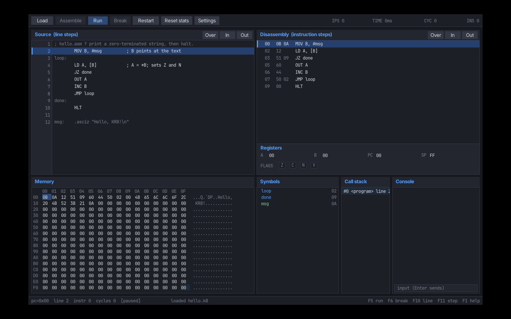
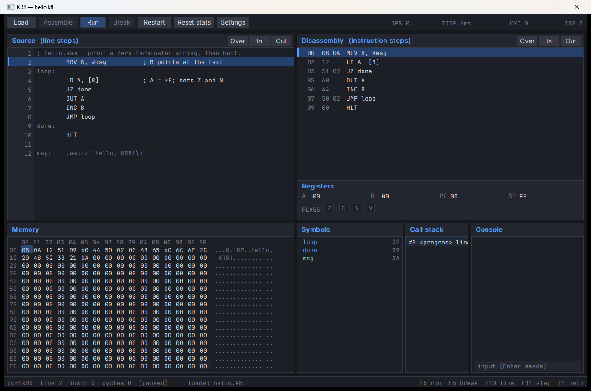
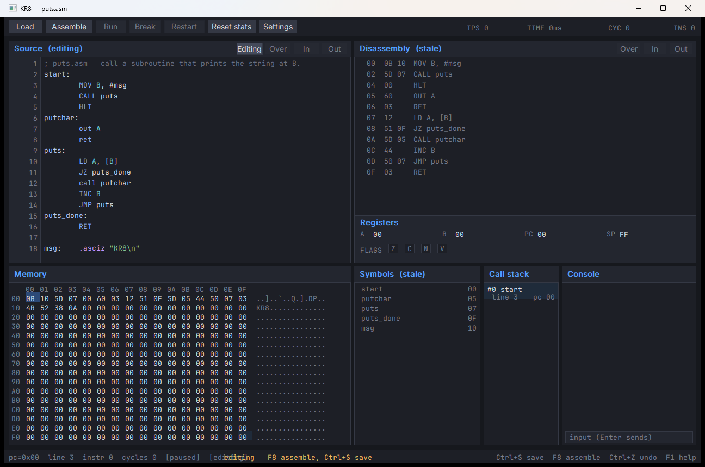
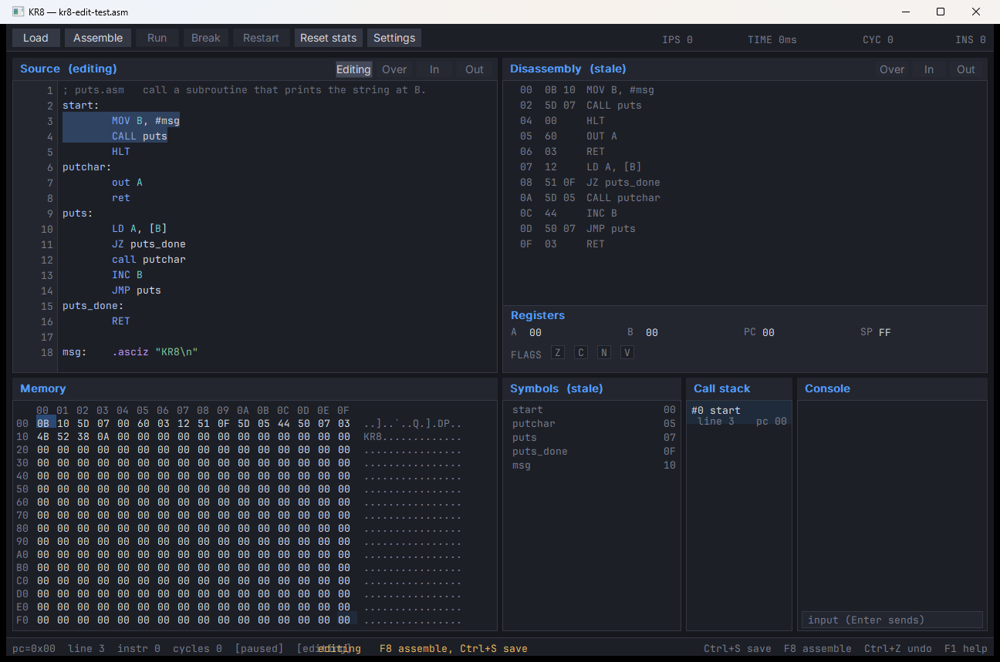
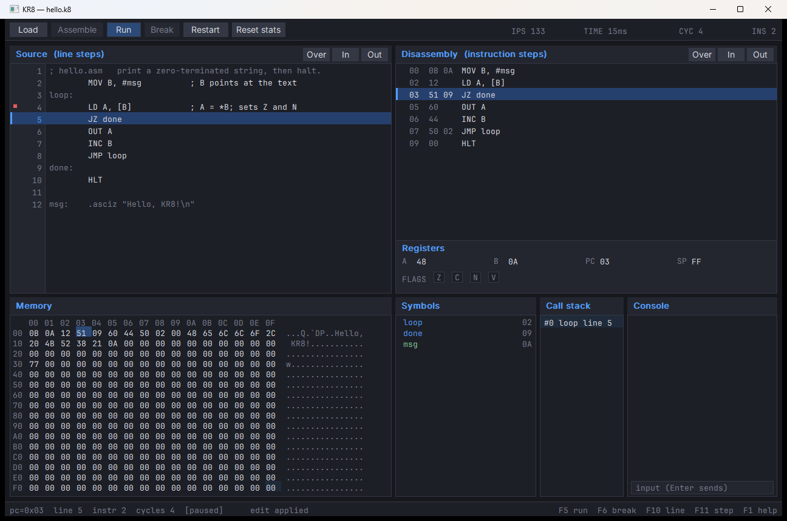
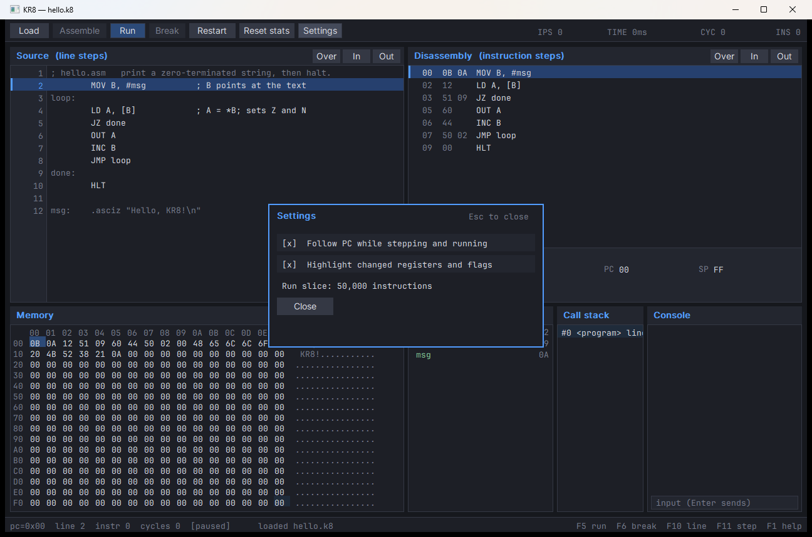
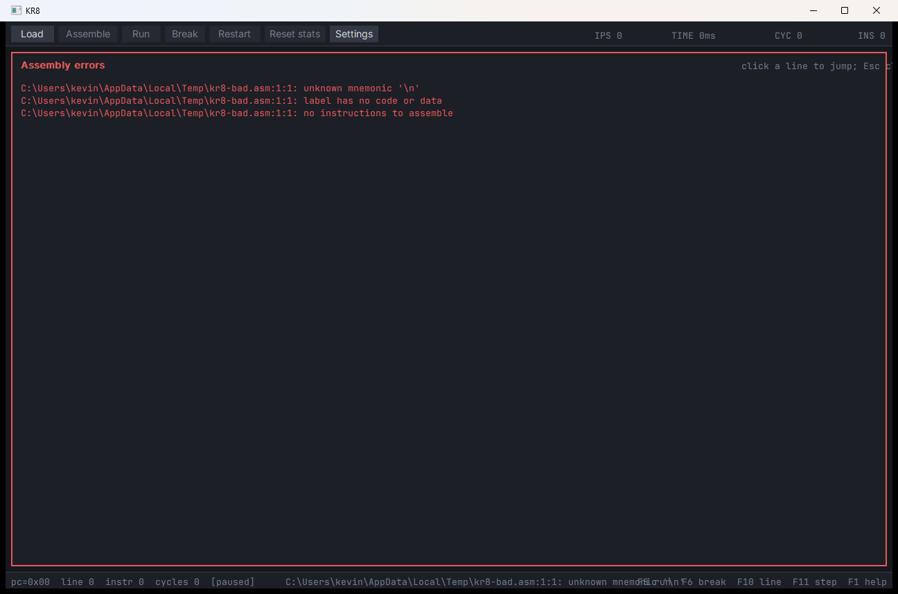

# KR8 Debugger

Status: Windows and Linux SDL3 UIs implemented  
Design: [../kr8-plan.md](../kr8-plan.md) §9  
Screenshots: [screenshots/](screenshots/)



The KR8 window is a focused assembly debugger modelled on KR16. It shows the
whole machine at once: source, disassembly, registers/flags, all 256 bytes of
RAM, symbols, the shadow call stack, and the console.

## 1. Starting the UI

```text
kr8                 open an empty debugger (spawns the window on Windows)
kr8 ui hello.asm    assemble and open a source file
kr8 ui hello.k8     open a self-contained image
```

Opening a `.asm`/`.s` file assembles it, writes the adjacent `.k8`, and loads
it. Opening a `.k8` loads symbols, line rows, and embedded source. Opening a
`.bin` loads the raw 256-byte image with no symbols or source.

On Windows the no-argument command spawns a detached `--ui` child without a
console. On Linux it runs the SDL3 window in-process.

## 2. Layout



- **Top bar** — Load, Assemble, Run, Break, Restart, Reset stats, Settings;
  INS/CYC/TIME/IPS counters on the right.
- **Source** (top left) — assembly source with line numbers, syntax colouring,
  current-line highlight, breakpoint gutter, and Over/In/Out line-step buttons.
  The **Edit** button opens the built-in multiline editor. Non-executable lines
  are dimmed in Debug mode.
- **Disassembly** (top right) — every decoded instruction with address, bytes,
  and symbol-aware text. The PC row is highlighted; address breakpoints live in
  the left gutter.
- **Registers** (under disassembly) — A, B, PC, SP, and the Z/C/N/V flags.
  Changed values are green; changed flags get an amber border.
- **Memory** (bottom left) — the full 16×16 memory map with address, hex, and
  ASCII columns. PC and SP bytes are highlighted.
- **Symbols** (bottom middle) — code/data/constant symbols with addresses.
- **Call stack** (bottom middle-right) — the shadow call stack, best effort.
- **Console** (bottom right) — program output and an input field for `IN`.
- **Status bar** — PC, source line, instruction/cycle counts, state, message,
  and key hints.

## 3. Running and stepping

| Action | Control |
|---|---|
| Run | `F5` or **Run** |
| Break | `F6` or **Break** |
| Restart | `F7` or **Restart** |
| Assemble current `.asm` | `F8`, **Assemble**, or `Ctrl+R` |
| Step source line | `F10` or **Over** in the Source pane |
| Step instruction | `F11` or **In** in the Disassembly pane |
| Step into | **In** |
| Step out | **Out** |

Source-line stepping uses the line table and the shadow call depth:

- **Over** runs until the source line changes at the same or a shallower call
  depth.
- **In** stops when the line changes at any depth.
- **Out** stops when the line changes after returning to a shallower depth.

Instruction stepping is exact: one CPU instruction per step. `Run` executes in
short slices so the window stays responsive; `Break` stops between slices.

## 4. Breakpoints

- **Line breakpoint** — click the source gutter. A red square appears.
  Clicking a comment or data line snaps forward to the next executable line and
  reports the move in the status bar.
- **Address breakpoint** — click the disassembly gutter.
- **Symbol breakpoint** — right-click a code or data symbol in the Symbols
  pane.

Breakpoints survive Restart and a successful reassembly. Continuing from a
breakpoint executes the instruction at the current PC once before the
breakpoint is checked again.

## 5. Editing source



The **Edit** button enters an explicit Edit mode for `.asm`/`.s` files. `.k8` and
`.bin` images remain read-only.

In Edit mode:

- Type, select with Shift+arrows or the mouse, drag-select, and double-click a
  word. The editor supports Ctrl+A/C/X/V, undo/redo, Home/End, Ctrl+arrows, and
  PageUp/PageDown.
- Enter copies the current indentation; a label line such as `loop:` adds one
  level. Tab inserts four spaces.
- `Ctrl+S` saves the `.asm` file. Unsaved changes prompt before Load or close.
- Syntax colouring distinguishes comments, labels, instructions, directives,
  registers, numbers, and strings.
- Run, Break, Restart, and all step controls are disabled. Press **F8** or
  **Assemble** to build the buffer.
- On success, KR8 writes the adjacent `.k8`, reloads it, resets PC to entry, and
  returns to Debug mode. Line breakpoints are kept by line number and snapped
  forward to the nearest executable line; address breakpoints are cleared.
- On failure, Edit mode stays open and the diagnostics overlay appears.
- While editing, Disassembly and Symbols are marked `(stale)` and dimmed; the
  last image remains visible as context.

`Esc` leaves Edit mode; if there are unsaved changes, KR8 asks before discarding
them.



## 6. Registers, flags, and memory



- Click a register value (A, B, PC, SP), type one or two hex digits, and press
  Enter. Esc cancels. Editing PC moves the current line; editing SP invalidates
  the shadow call stack until Restart.
- Click a flag box to toggle Z, C, N, or V.
- Click a memory byte, type two hex digits, and press Enter. Editing a code byte
  changes what executes.
- Hover a memory byte for its address, hex value, decimal value, and symbol.
- The memory map is always complete; there is nothing to scroll.

## 7. Symbols, call stack, and console

- Click a code symbol to set PC to its address. Click a data symbol to select
  it in the memory map. Right-click a symbol to toggle an address breakpoint.
- The call stack is a debugger-side shadow stack updated by `CALL`/`RET`.
  Each frame uses two lines: the function/index, then its source line and
  `ret` or `pc` value. `#0` is the current function; clicking a frame moves PC
  to the caller's call instruction. It is exact for structured code and labelled
  "best effort" in the plan; `RET` without `CALL` and return-address mismatches
  are reported.
- Click the console input, type, and press Enter. The text plus a newline is
  queued for `IN`. `Esc` leaves the input field.

## 8. Help and tooltips

- `F1` opens a two-column quick reference covering registers, flags, memory,
  all 63 instructions, directives, and keys.
- Hover a disassembly row for the instruction's help and operand forms.
- Hover a memory byte for address/value/symbol details.
- Hover the top-bar buttons for hit feedback and the hand cursor.

## 9. Settings



**Settings** contains:

- **Follow PC** — keep the source and disassembly panes scrolled to the current
  instruction.
- **Highlight changed values** — colour registers green and mark changed flags
  after a step or run.
- The run slice size is currently fixed at 50,000 instructions per 8 ms slice.

Settings are stored in `%APPDATA%\KR8\settings.ini` on Windows, or
`$XDG_CONFIG_HOME/kr8/settings.ini` / `~/.config/kr8/settings.ini` on Linux.
They survive an application restart.

## 10. Errors



A failed assembly opens an error overlay with file, line, column, and message.
Clicking a row jumps the source pane to that line; Esc closes the overlay. The
previous image remains loaded and step-able, so a bad edit does not destroy the
debug session.

## 11. Keyboard reference

| Key | Action |
|---|---|
| `F1` | Help overlay |
| `F5` | Run |
| `F6` | Break |
| `F7` | Restart |
| `F8` | Assemble |
| `F10` | Step line |
| `F11` | Step instruction |
| `Ctrl+O` | Load file |
| `Ctrl+R` | Assemble/reload |
| `Ctrl+S` | Save source (Edit mode) |
| `Ctrl+Z` / `Ctrl+Y` | Undo / redo (Edit mode) |
| `Ctrl+A` / `Ctrl+C` / `Ctrl+X` / `Ctrl+V` | Select all / copy / cut / paste |
| `Enter` | Newline with auto-indent (Edit mode) |
| `Tab` | Insert four spaces (Edit mode) |
| `Esc` | Close help/settings/errors, cancel edit, leave console input |

## 12. Known limits

- The editor has no find/replace, code folding, or multi-file support yet.
- The call stack is a shadow stack, not a frame-pointer walk. It is best effort
  for code that breaks the `CALL`/`RET` structure.
- Conditional breakpoints, watch expressions, and reverse execution are not
  implemented.
- The settings surface is deliberately small; font size is fixed by the
  platform backend.
