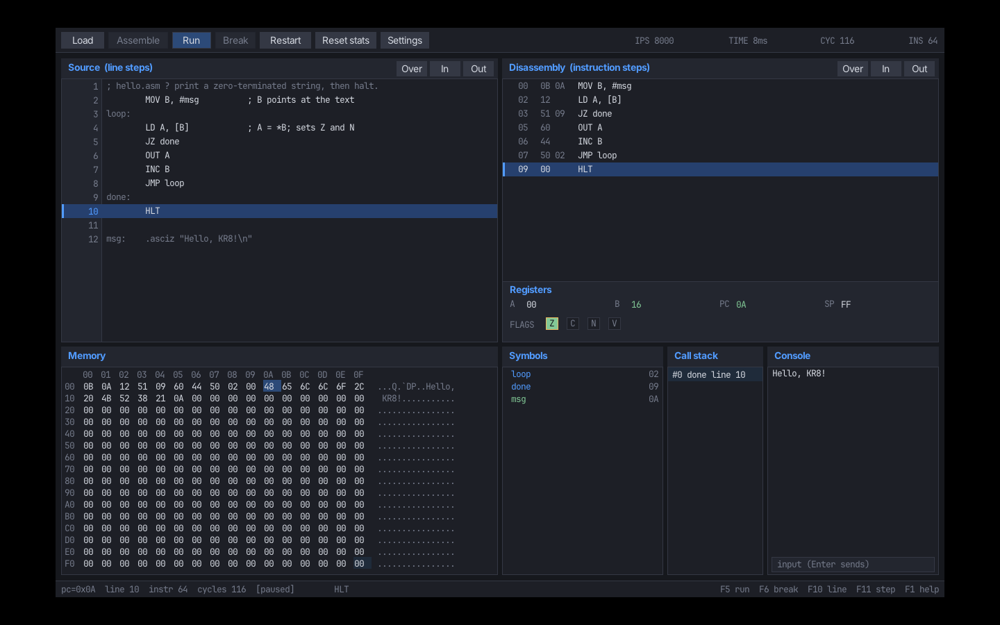

# Building and verifying release artifacts

Artifacts are written to `dist/` (ignored by Git).

## Windows

Requirements: Visual Studio 2026 with the C++ workload, CMake 3.25+.

```powershell
cmake --preset windows-vs2026
cmake --build --preset windows-vs2026-release
```

The executable is `build/windows-vs2026/Release/kr8.exe`. It is linked with
`/MT`, embeds the UI fonts, and depends only on `USER32.dll`, `GDI32.dll`,
`COMDLG32.dll`, and `KERNEL32.dll`.

Package with `packaging/windows.ps1` from a Visual Studio developer prompt, or
stage `kr8.exe` plus `README.md`, `LICENSE`, `THIRD_PARTY_NOTICES.md`, `docs/`,
and `examples/` and zip the directory.

## Linux x64 AppImage

Build on the oldest supported distribution (Ubuntu 22.04) so the AppImage does
not require a newer glibc than the target. With SDL3 installed or supplied via
`KR8_SDL3_SOURCE_DIR`:

```bash
cmake --preset linux-gcc-release -DKR8_BUILD_UI=ON
cmake --build --preset linux-gcc-release
APPIMAGETOOL=/path/to/appimagetool APPIMAGE_EXTRACT_AND_RUN=1 \
  bash packaging/linux-appimage.sh
```

The script creates `dist/KR8.AppDir` and `dist/KR8-x86_64.AppImage`. The AppDir
contains the `kr8` binary, the icon, a desktop file, and the license/notice
files under `usr/share/doc/kr8/`.



## Verification

```text
Windows:  dumpbin /DEPENDENTS kr8.exe
Linux:    ldd dist/KR8.AppDir/usr/bin/kr8
          objdump -T dist/KR8.AppDir/usr/bin/kr8 | grep GLIBC
```

Clean-environment checks:

- Extract the Windows zip into an empty directory, then run
  `kr8 --version`, `kr8 as examples/hello.asm -o hello.k8`, and
  `kr8 run hello.k8`.
- Run the AppImage in a clean Ubuntu 22.04 environment with
  `--appimage-extract-and-run --version`, then run `examples/hello.asm` and the
  UI.

The GitHub workflows in `.github/workflows/` run the full test matrix and
publish the two artifacts on a `v*` tag.
